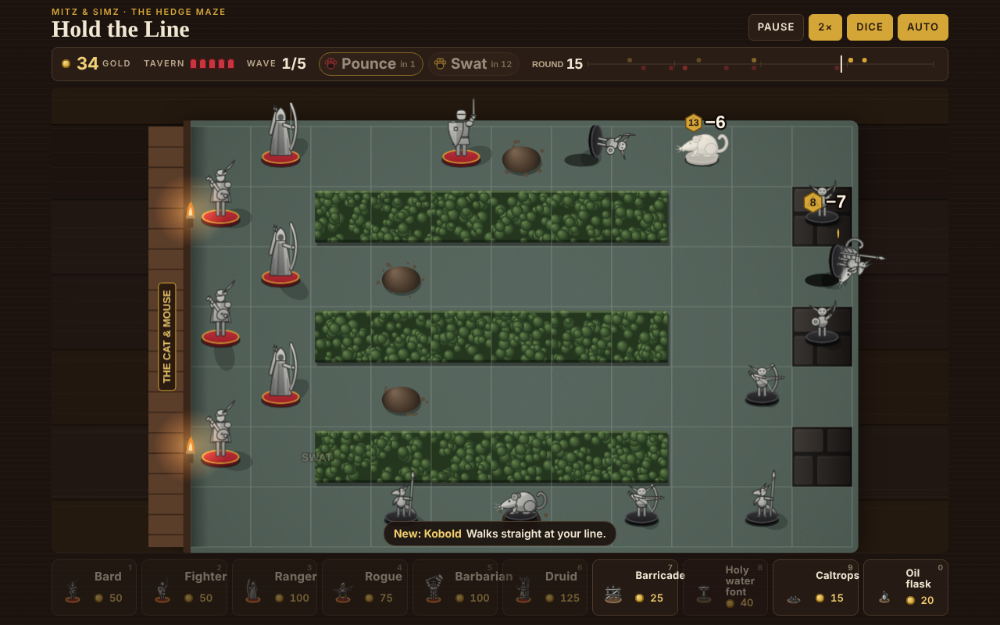
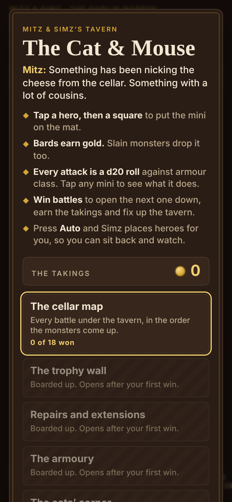

# Mitz & Simz: Hold the Line

A lane-defence game for the browser, played with unpainted minis on a battle mat. Monsters come up from under the Cat & Mouse, Mitz and Simz's tavern, and you hold the line with a party of heroes. Every attack is a d20 roll against armour class.

**Play it:** https://mitznsimz-cpu.github.io/mitznsimz-hold-the-line/

It is in beta: the version number is on the Credits screen. It runs in any modern browser on a phone, tablet or desktop, with nothing to install.

 

## What's in it

- **36 battles** of five waves each: 18 in the cellar and 18 in the house (the kitchens, the brewhouse, the stables, the beer garden, the well and ice house, and the attic and roof), on 25 floors with pillars, water, chasms, ovens, barrel chutes, trapdoors, hedges, ice and skylights.
- **13 heroes**, each levelling to 3 and choosing one of two paths there. You take six into each battle. There are four cheap defenders too: barricades, holy water fonts, caltrops and oil flasks.
- **66 monsters**, several of which break a rule the heroes rely on, plus the house's own bosses.
- **The Cat & Mouse** is the hub: the cellar map, the house plan, the trophy wall, repairs, the armoury, the cats' corner and the back room (Endless, the Daily Challenge, the Boss Rush, five puzzles and Reverse).
- **Mitz and Simz** help out. Mitz pounces and Simz swats, and they take turns being on watch. Press **Auto** and Simz plays the battle for you.
- Four difficulties, from Easy to Deadly. Every effect can be switched off in Settings, and there's a Reduced motion option.

## For beta testers

- **Saves** are kept in your browser, for this web address only. To keep a copy, or to move your campaign to another browser or device, use **Export** and **Import** under Settings in the tavern. Clearing your browser's site data wipes your progress, so export first.
- **Changing the save's shape:** raise `VERSION` in `campaign.js`, add a step to `STEPS`, and put an example of the old shape in `tests/saves/` (see its README). The tests load every example.
- **Reporting a bug:** open an issue on this repo, or email mitznsimz@gmail.com. Please include:
  - the version number from the Credits screen;
  - the battle and the difficulty;
  - your device and browser;
  - what happened, and what you expected to happen.

  A screenshot helps a lot.
- **Worth trying:**
  - play the house battles;
  - play on a phone;
  - pick a party Simz didn't suggest;
  - play the Daily Challenge.

## Run it locally

There's no build step. You can open `index.html` in a browser, or serve the folder:

```sh
python3 -m http.server 8000
# then open http://localhost:8000/
```

The only things fetched from the internet are two Google Fonts. If they can't load, the game uses fallback fonts.

## Tests

The tests need Node 18 or later; they were run on Node 22. Running them from anywhere:

```sh
bash tests/run_gate.sh          # syntax, the game tests and the minis tests (about a minute)
bash tests/run_gate.sh --full   # adds the balance report, a 1,440-game stall hunt and the browser tests (a few minutes)
```

You can also run each part on its own:

```sh
node tests/hold-the-line.test.js [--quick]   # the rules, every hero, monster and mode, replays, and a balance report
node tests/minis.test.js                     # the minis library and Hold the Line's adapter
node tests/balance.js maze,attic 20          # Simz on all four difficulties, plus a slow builder (battle ids, or "all")
node tests/stalls.js 40                      # hunts for games that never end (games per battle)
node tests/browser.test.js [--only menu]     # the game in a real browser, served from a sub-folder as on GitHub Pages
```

The browser tests drive Chromium through [Playwright](https://playwright.dev). Install it once with `npm i -D playwright && npx playwright install chromium`; without it they're skipped. They check what the page does rather than how its source is written: the tab, the credits and their links, the support line, menus that stop redrawing the board, the board's pixel budget on Safari and how it adapts to a slow browser, the battle clock, the drawing calls Safari is slow at, and a campaign played to its end. `window.HTL_VIEW` is a small read-only hook they use; the game itself doesn't.

These are the gate a release has to pass:

- every test passes;
- Simz wins at least 80% of each battle on Medium;
- a slow, hesitant builder wins no more than 90%;
- Simz wins at least 70% on Hard overall;
- Deadly comes in at 50% or more overall, and no easier than Hard;
- no stall-hunt game ever stalls;
- the browser tests pass, on a desktop and a phone size;
- a playthrough in Safari, on a Mac and an iPhone or iPad, by hand.

`tests/fixtures/` holds frozen copies of the v1.0, v1.1 and v1.2 rules. The battles from those versions must still replay exactly, seed for seed, so their waves and maps don't change.

## How it fits together

The page loads its scripts in this order:

| File | What it does |
|---|---|
| `index.html` | The page, its styles, and the script tags in load order |
| `icon.svg`, `icon-*.png` | The browser-tab and home-screen icons |
| `manifest.webmanifest`, `sw.js` | Installing to the home screen, and playing offline after one visit. Network first: online, every file is fetched fresh, so updates arrive as before |
| `mitznsimz_minis.js` | The shared minis library (core 2.5.0), with Hold the Line's adapter at the end |
| `motion.js` | How the minis move, and the effects between them: arrows, spells, hit-stop, particles, the tumbling d20, the cats' paws (1.1.0) |
| `sound.js` | Sound, all made in the browser; no audio files (1.0.0) |
| `pack-core.js` | Content: heroes, paths, monsters, maps, battles, items |
| `sim.js` | The rules engine: placement, combat, traits (`TRAITS`), the events it sends (`EVENTS`), suggested parties |
| `simz.js` | Simz, the cats' own player: the Auto button, the balance tests and the keeper in Reverse. He reaches the rules only through `HTL`, and `HTL.look` for questions about the board |
| `modes.js` | Endless, the Daily Challenge, the Boss Rush, the puzzles and Reverse |
| `campaign.js` | The tavern hub: progress, takings, upgrades, trophies and the save |
| `view/core.js` | The view's setup: settings, the battle state it draws, and laying the board out to fit the window |
| `view/board.js` | The board's pieces: the mat, the pillars, and the minis as sprites with their poses |
| `view/events.js` | Each event from the rules becomes animation, sound and words on the board |
| `view/draw.js` | Drawing the board each frame, in depth order, with the effects on top |
| `view/motes.js` | Dust, drips, embers, spores, leaves or snow drifting over the board, from each battle's theme (after the Delve's particles) |
| `view/hud.js` | The battle's panels: the initiative track, the HUD and hero tray, the belt, the cats' powers, a mini's card, the next wave |
| `view/tavern.js` | The Cat & Mouse between battles: the hub and every room, and the common room where a party is picked |
| `view/app.js` | Input, settings and credits, the main loop (with Frame timings and the adaptive sharpness), and boot |

The `view/` files are plain scripts that share one scope: what one declares at the top, the others can use, as when they were a single `game.js`. They load in the order above, and only `app.js` starts anything, so a file may use what a later one declares, but only from inside a function.

The rules come first, and they never touch the page. Given a seed, `sim.js` and `pack-core.js` always play the same game, so the tests can run whole battles headless. The view only draws the events the rules give it: every one is listed in `HTL.EVENTS`, and `view/events.js` either shows it or says, in `SHOWN_FROM_STATE`, why it needs nothing. A new event is added to both, or the tests fail.

### Shared with Dungeon Delve

- **`mitznsimz_minis.js`.** Everything between the `MINI CORE START` and `MINI CORE END` markers is the shared library, and the Dungeon Delve owns the canonical copy. Make changes to figures there, then copy the core block across. To check that the two copies match, run `node tests/minis.test.js mitznsimz_minis.js path/to/delve/mitznsimz_minis.js`.
- **`motion.js`.** Hold the Line owns this one and Dungeon Delve uses it too, so changes need to work in both games.

## Roadmap and history

[`docs/ROADMAP.md`](docs/ROADMAP.md) is a snapshot of the roadmap as it stood at v1.7.8. It has all seven phases and a progress log of every release since v0.1.

## Licence

The code is under the MIT licence (see [`LICENSE`](LICENSE)): use it, change it, share it. That doesn't cover the Mitz & Simz characters or their artwork: the miniatures drawn by `mitznsimz_minis.js` and the icon are © MitzNSimz.

This work includes material taken from the System Reference Document 5.1 ("SRD 5.1") by Wizards of the Coast LLC and available at https://dnd.wizards.com/resources/systems-reference-document. The SRD 5.1 is licensed under the Creative Commons Attribution 4.0 International License available at https://creativecommons.org/licenses/by/4.0/legalcode.

Hold the Line is unofficial and is not endorsed by Wizards of the Coast.

## Credits

Made by Pete at [MitzNSimz](https://mitznsimz.co.uk), Folkestone.

- ☕ [Enjoying it? Buy Pete some dice, or Mitz & Simz some treats.](https://ko-fi.com/mitznsimz)
- 🛡 [MitzNSimz.co.uk](https://mitznsimz.co.uk): 3D-printed miniatures and tools for Dungeon Masters.
- More from Mitz & Simz: [Dungeon Delve](https://mitznsimz-cpu.github.io/mitznsimz-dungeon-delve/) (a first-person dungeon crawler that shares the miniatures library and the fight animation), [Tarokk](https://mitznsimz-cpu.github.io/mitznsimz-tarokk/) and the [D&D Encounter Tracker](https://mitznsimz-cpu.github.io/DnD-Encounter-Tracker/).

No ads and no tracking: your progress stays in your browser.
